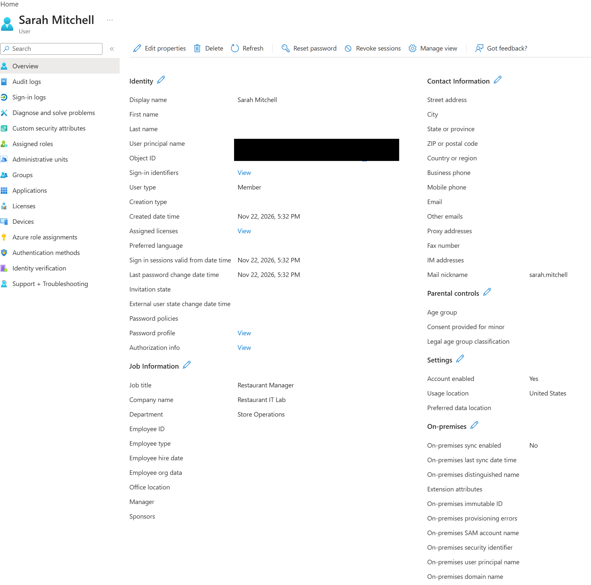
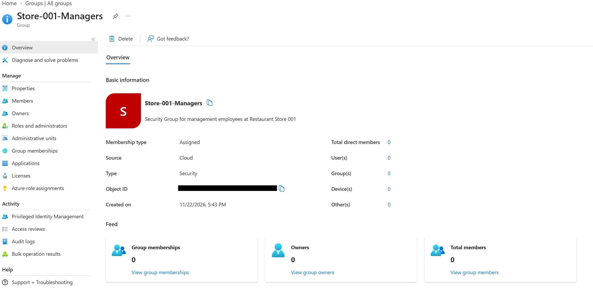
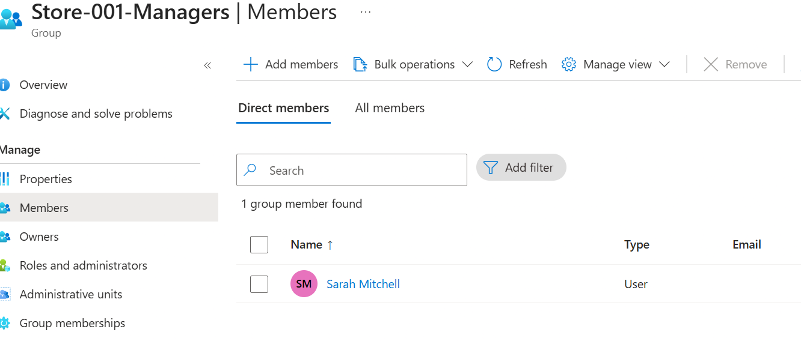
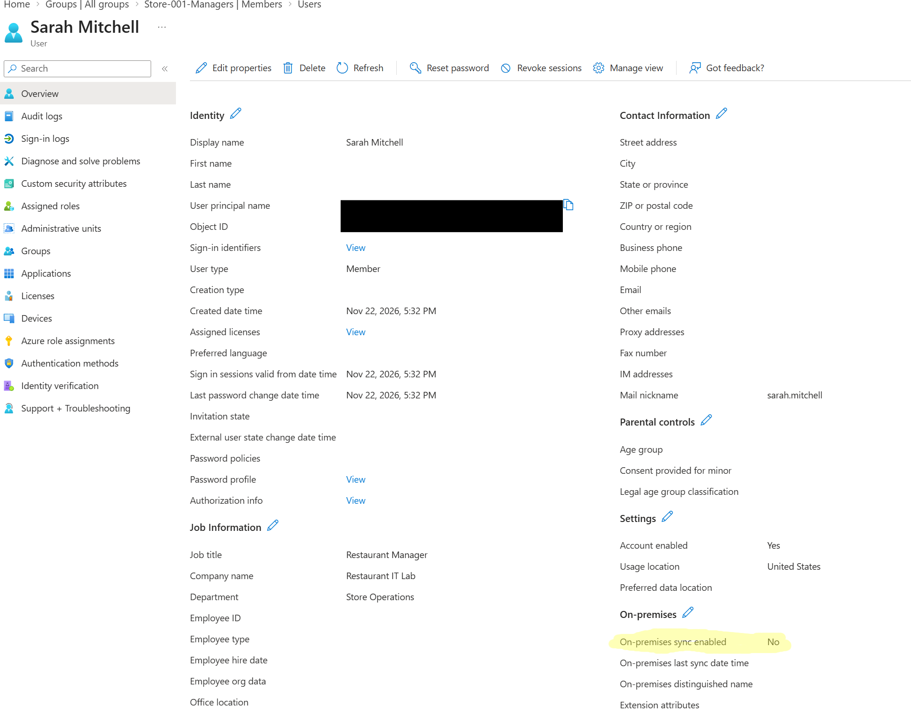
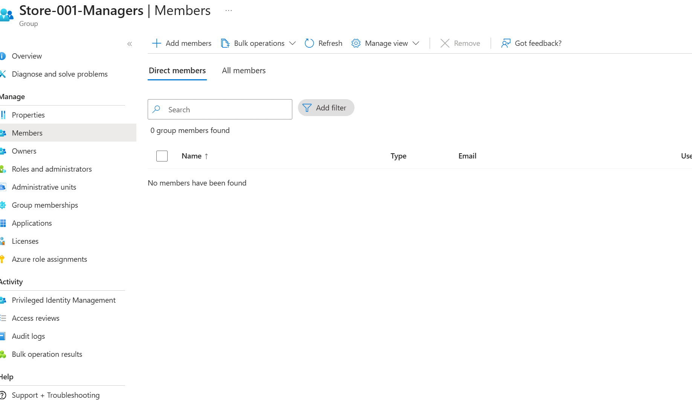

# Microsoft Entra ID — Employee Lifecycle Management Lab

## Overview
A hands-on identity administration lab simulating employee onboarding, group membership management, and offboarding for a fictional multi-location restaurant business. Built as preparation for an entry-level Systems Technician role.

## Objectives
- Create and configure a cloud-only employee identity.
- Organize employee access using an assigned security group.
- Simulate secure offboarding by disabling the account, revoking sign-in sessions, and removing group membership.
- Verify and document each administrative change.

## Environment
- Microsoft Entra admin center
- Microsoft Entra ID tenant
- Global Administrator account for lab administration
- Fictional employee: Sarah Mitchell, Restaurant Manager, Store 001
- Assigned security group: `Store-001-Managers`

> **Scope:** This lab demonstrates identity lifecycle operations. It does not configure application authorization, Microsoft 365 licensing, Conditional Access policies, or Intune device management. Group membership alone does not grant application access.

## Architecture

The administrator manages a fictional restaurant employee identity in Microsoft Entra ID. The employee is initially a member of `Store-001-Managers`. During offboarding, the administrator disables the account, revokes sign-in sessions, and removes the group membership.

## Procedure and evidence

### 1. Provision employee account
Created a cloud-only user, Sarah Mitchell, and configured the employee profile for a Store 001 Restaurant Manager.

### 2. Create assigned security group
Created the `Store-001-Managers` security group to organize restaurant management identities.

### 3. Assign group membership
Added Sarah Mitchell to the security group and verified her membership.

### 4. Simulate employee offboarding
Disabled Sarah's account, revoked her sign-in sessions, removed her from `Store-001-Managers`, and verified the updated state.

## Verification
| Check | Result |
| --- | --- |
| Employee user created | Completed |
| Security group created | Completed |
| Employee added to group | Completed |
| Employee account disabled | Completed |
| Sign-in sessions revoked | Completed |
| Employee removed from group | Completed |
| Membership removal verified | Completed |

## Key takeaways
- Microsoft Entra ID provides centralized cloud identity administration.
- Assigned security groups simplify organizing users for downstream access management, but do not themselves confer application permissions.
- Offboarding involves multiple distinct controls: disabling sign-in, revoking sessions, and removing access-related group memberships.
- Revoking sign-in sessions does not guarantee immediate expiration of all previously issued access tokens.
- Documenting and verifying changes is an important part of IT operations.

## Security and privacy
All users and company names are fictional. Screenshots should be redacted before publication to hide tenant IDs, real administrator details, passwords, tokens, and other sensitive information. This lab is not connected to a production restaurant environment.

## Future improvements
- Create separate staff and manager groups for multiple locations.
- Explore least-privilege delegated administration in a licensed test tenant.
- Test application assignments and sign-in behavior in a supported sandbox.
